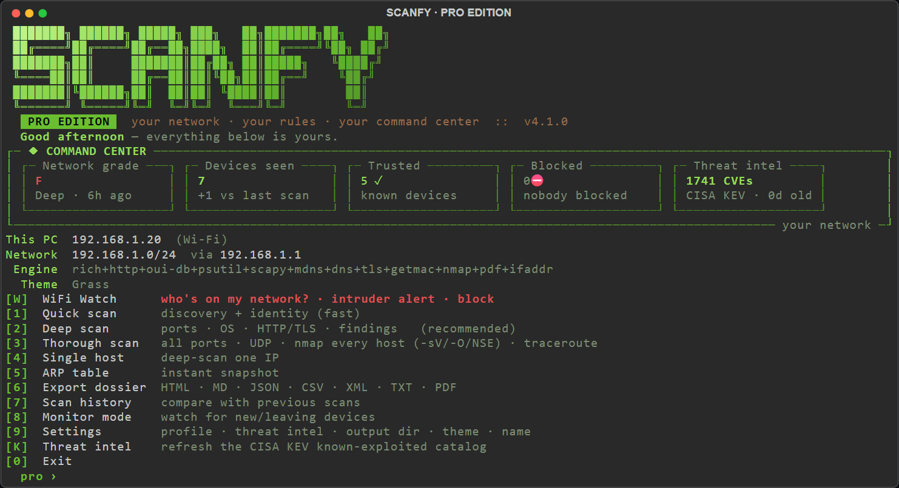
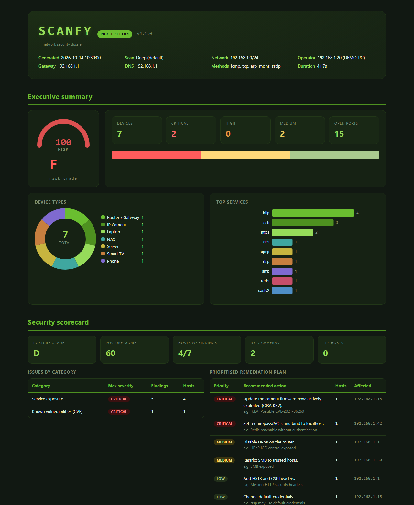

[README.md](https://github.com/user-attachments/files/33457547/README.md)
<div align="center">

```
 ███████╗ ██████╗ █████╗ ███╗   ██╗███████╗██╗   ██╗
 ██╔════╝██╔════╝██╔══██╗████╗  ██║██╔════╝╚██╗ ██╔╝
 ███████╗██║     ███████║██╔██╗ ██║█████╗   ╚████╔╝
 ╚════██║██║     ██╔══██║██║╚██╗██║██╔══╝    ╚██╔╝
 ███████║╚██████╗██║  ██║██║ ╚████║██║        ██║
 ╚══════╝ ╚═════╝╚═╝  ╚═╝╚═╝  ╚═══╝╚═╝        ╚═╝
                    P R O   E D I T I O N
```

### 🌿 Network Scanner · Intruder Watch · Threat Intel · Security Dossier

**SCANFY Pro** discovers every device on your Wi-Fi/LAN, identifies what it is,
checks its security against live threat intelligence, warns you when an
**unknown device** joins your network and produces a **complete, beautiful
security dossier** in HTML or PDF, all from **a single Python file**.


<br>



</div>

---

## ⚡ Get started in 30 seconds

```bash
# 1) Get the code: "Code → Download ZIP" on this page, or clone the repository,
#    then open a terminal inside the folder

# 2) Install the dependencies
pip install -r requirements.txt

# 3) Run it
python scanfy_pro.py
```

> 💡 On some systems use `python3` instead of `python`. On Windows you can also
> just double-click **`run_scanfy_pro.bat`**.
> Only `rich` is strictly required: everything else unlocks more power and
> degrades gracefully when missing.

---

## 📑 Table of contents

- [Features](#-features)
- [The Command Center](#-the-command-center)
- [WiFi Watch: intruder detection](#-wifi-watch-intruder-detection)
- [Installation](#-installation)
- [Usage](#-usage)
- [Scan profiles](#-scan-profiles)
- [The dossier](#-the-dossier)
- [Dependencies](#-dependencies)
- [Works anywhere in the world](#-works-anywhere-in-the-world)
- [Privacy: where your data lives](#-privacy-where-your-data-lives)
- [How it works](#-how-it-works)
- [FAQ](#-faq)
- [Legal & ethical use](#-legal--ethical-use)
- [License](#-license)

---

## ✨ Features

<table>
<tr>
<td width="50%" valign="top">

### 🔍 Multi-method discovery
- ICMP ping sweep (TTL + latency)
- TCP "ping" (finds ICMP-blocking hosts)
- ARP table **+ optional layer-2 ARP** (scapy)
- **mDNS / Bonjour** (zeroconf)
- **SSDP / UPnP** device descriptions
- **WS-Discovery** (printers / ONVIF cameras)
- NetBIOS names & UDP service probes

</td>
<td width="50%" valign="top">

### 🧬 Deep per-device research
- Port scan: **100 → 255 → 1,180 ports**
- Banner grabbing + product/version parsing
- Active probes: **FTP, SMTP, MySQL, Redis,
  Memcached, RTSP, RDP, VNC, MQTT**
- Dedicated **HTTP/HTTPS, TLS cert, SSH,
  SNMP, SMB, DNS** fingerprinters
- OS fingerprint (TTL + banners + **nmap**)

</td>
</tr>
<tr>
<td width="50%" valign="top">

### 🏷️ Identity & classification
- Full **IEEE OUI** vendor database
- Reverse DNS · NetBIOS · mDNS · UPnP names
- Scoring-based device classifier:
  router, camera, printer, NAS, phone,
  IoT/ESP, smart speaker, TV, PC, VM, BMC…
- MAC-randomization aware

</td>
<td width="50%" valign="top">

### 🛡️ Security analysis
- **46** exposed-service & legacy-protocol rules
- TLS weakness & missing-header checks
- **No-auth / default-credential** detection
  (Redis, Memcached, anon FTP, open MQTT…)
- **CVE** hints + optional live **NVD** lookups
- Per-device **risk score**, network grade
  **A–F** & prioritised remediation plan

</td>
</tr>
<tr>
<td width="50%" valign="top">

### 🚨 Threat intelligence
- **CISA KEV** catalog (vulnerabilities known to
  be *exploited in the wild*), cached offline
- Any KEV match is raised to **critical** and
  marked `[KEV]`, with ransomware context
- Optional **NVD 2.0** CPE → CVE lookups with
  CVSS scores (rate-limited, cached)

</td>
<td width="50%" valign="top">

### 📡 WiFi Watch & monitoring
- **Who's on my network?** census
- Trusted list → anything new is an **intruder**
- **Router-based block** guides for **29 router
  families / 39 brands**, MAC copied for you
- **Monitor mode** alerts on join / leave
- **SQLite history** + new/gone/changed diff

</td>
</tr>
</table>

### 📊 Complete dossier
- Self-contained **HTML** dossier: risk gauge, SVG charts, security scorecard,
  findings register, topology overview, inventory and a **card for every device**.
- **Styled PDF** and **formal PDF** (signature block + data-protection notice)
  in **English · Português · Español · Français · Deutsch · Italiano**.
- Also exports **Markdown · JSON · CSV · XML · TXT**.
- **5 colour themes** (Grass, Neon Synthwave, Deep Ocean, Ember, Royal Gold) that
  restyle both the terminal and the reports.

---

## 🧭 The Command Center

Every time SCANFY Pro opens, the home screen summarises your network at a glance:

| Tile | Shows |
|------|-------|
| **Network grade** | the latest security grade (A–F) and when it was measured |
| **Devices seen** | how many devices were found, and the change since the previous scan |
| **Trusted / Blocked** | the size of your trusted list and your blocklist |
| **Threat intel** | how many known-exploited CVEs are cached, and how fresh the catalog is |

Set your name in **Settings → `O`** to be greeted by name (nothing is filled in by
default) and pick a colour theme in **Settings → `T`**.

---

## 📡 WiFi Watch: intruder detection

1. Press **`W`**: SCANFY lists every connected device with vendor, name and type.
2. Mark the devices you recognise with **`T` (Trust)**.
3. From then on, anything not on your trusted list shows up as **⚠ UNKNOWN**.
4. **`B` (Block)** detects your router's brand, shows the exact menu path to
   block that one device, copies its MAC address and opens the router page.
   Later scans confirm the block worked, or raise a **⛔ BLOCKED-STILL-HERE**
   alert.

> 🛑 SCANFY never sends Wi-Fi *deauthentication* frames. That technique jams the
> radio for everyone nearby, is illegal in many countries and only lasts a few
> seconds. Blocking in the router is surgical and permanent.

---

## 📦 Installation

```bash
pip install -r requirements.txt
python scanfy_pro.py
```

**Requirements:** Python **3.8+**. Works on **Windows**, **Linux** and **macOS**.
SCANFY Pro is one self-contained file (`scanfy_pro.py`): nothing to build,
no administrator rights needed.

<details>
<summary><b>🔧 Optional power-ups (click to expand)</b></summary>

<br>

| Extra                     | Unlocks                                       | Notes |
|---------------------------|-----------------------------------------------|-------|
| `scapy` + **Npcap**       | Layer-2 ARP scan discovery                    | Npcap is a driver, install it separately on Windows ([npcap.com](https://npcap.com)) |
| `python-nmap` + **nmap**  | nmap service/OS/NSE detection                 | on Windows run **`setup_nmap.ps1`**, it installs and configures nmap for you |
| `reportlab`               | PDF dossiers                                  | included in `requirements.txt` |

The home screen shows an **Engine** line listing which capabilities are active.

</details>

<details>
<summary><b>📁 What's in this folder (click to expand)</b></summary>

<br>

| File | What it is |
|------|------------|
| `scanfy_pro.py` | the whole tool, in one file |
| `requirements.txt` | Python libraries to install with `pip` |
| `run_scanfy_pro.bat` | Windows launcher (double-click) |
| `setup_nmap.ps1` | optional: installs/configures **nmap** for the Thorough scan |
| `assets/` | the images used in this README |

</details>

---

## 🚀 Usage

### Interactive menu
```bash
python scanfy_pro.py
```
```
  [W] WiFi Watch       who's on my network? · intruder alert · block
  [1] Quick scan       discovery + identity (fast)
  [2] Deep scan        ports · OS · HTTP/TLS · findings   (recommended)
  [3] Thorough scan    all ports · UDP · nmap every host (-sV/-O/NSE) · traceroute
  [4] Single host      deep-scan one IP
  [5] ARP table        instant snapshot
  [6] Export dossier   HTML · MD · JSON · CSV · XML · TXT · PDF
  [7] Scan history     compare with previous scans
  [8] Monitor mode     watch for new/leaving devices
  [9] Settings         profile · threat intel · output dir · theme · name
  [K] Threat intel     refresh the CISA KEV known-exploited catalog
  [0] Exit
```

### Headless CLI (automation / scheduled scans)
```bash
python scanfy_pro.py -p deep -f all                         # deep scan → every format
python scanfy_pro.py -t 192.168.0.1 -f html                 # one host → HTML dossier
python scanfy_pro.py -n 192.168.0.0/24 -f dossier --lang es # formal PDF in Spanish
python scanfy_pro.py -p thorough -f pdf -o ./reports        # thorough scan → PDF in ./reports
python scanfy_pro.py -t 192.168.0.10 --nmap --cve-online    # + nmap and live NVD CVE lookups
python scanfy_pro.py --update-kev                           # refresh threat intel
python scanfy_pro.py --update-oui                           # refresh the vendor database
python scanfy_pro.py --help                                 # every option
```

Reports are saved as `scanfy_pro_dossier_YYYYMMDD_HHMMSS.<ext>`
(formal PDF: `scanfy_pro_formal_dossier_…pdf`).

---

## 🎚️ Scan profiles

| Profile     | TCP ports | UDP | HTTP | TLS | SNMP | SMB | mDNS | SSDP/WSD | Traceroute | nmap |
|-------------|----------:|:---:|:----:|:---:|:----:|:---:|:----:|:--------:|:----------:|:----:|
| `fast`      | 100       | ❌  | ✅   | ❌  | ❌   | ✅  | ✅   | ❌       | ❌         | ❌   |
| `default`   | 255       | ❌  | ✅   | ✅  | ✅   | ✅  | ✅   | ✅       | ❌         | ❌   |
| `deep`      | 255       | ✅  | ✅   | ✅  | ✅   | ✅  | ✅   | ✅       | ✅         | ❌   |
| `thorough`  | 1,180     | ✅  | ✅   | ✅  | ✅   | ✅  | ✅   | ✅       | ✅         | ✅ * |

<sub>* when the nmap binary is installed: version detection, OS detection and NSE `default`/`vuln` scripts on every host. Thorough covers ports 1–1024 plus well-known high ports.</sub>

---

## 📄 The dossier

<div align="center">

</div>

<br>

The HTML report is a full, offline, self-contained document:

- **Cover**: network, operator station, gateway, DNS, methods, engine.
- **Executive summary**: risk gauge, severity bar, device-type donut, top-services bars.
- **Security scorecard**: posture grade, issues by category, prioritised remediation plan.
- **Findings register**: every issue with severity, host, service, CVEs and a fix.
- **Topology overview**: gateway/scanner at the centre, hosts grouped by type.
- **Inventory**: every device with MAC, vendor, name, type, OS, risk and ports.
- **Per-device cards**: identity, open-port table, HTTP/TLS details, mDNS/UPnP
  data, tags and per-device findings.

<details>
<summary><b>🌐 PDF languages, themes & the formal dossier (click to expand)</b></summary>

<br>

- **Languages:** both PDFs can be written in **English, Português, Español,
  Français, Deutsch or Italiano**. Choose when exporting, in **Settings → `7`**,
  or with `--lang`. The last choice is remembered. Findings produced by the
  scanner itself (titles, recommendations) stay in English.
- **Formal dossier:** a sober, printable report with cover sheet, investigation
  details, executive summary, inventory, findings, per-device detail, signature
  block and a **confidentiality / data-protection** section written for
  international use. Dates include the UTC offset (e.g. `UTC+01:00`).
- **Themes:** the colour theme you pick also restyles the HTML and the styled PDF.

</details>

---

## 🧩 Dependencies

| Library             | Purpose                                         | Fallback if missing |
|---------------------|-------------------------------------------------|---------------------|
| `rich` *(required)* | terminal interface                              | won't start |
| `requests`          | HTTP/TLS-UI fingerprint, UPnP, public IP, threat intel | stdlib for threat intel, rest skipped |
| `mac-vendor-lookup` | full offline IEEE OUI vendor DB                 | small built-in table |
| `psutil` / `ifaddr` | real subnet-mask / interface detection          | assumes /24 |
| `zeroconf`          | mDNS / Bonjour discovery                        | skipped |
| `dnspython`         | PTR / version.bind fingerprint                  | stdlib reverse DNS |
| `cryptography`      | X.509 / TLS certificate parsing                 | limited TLS info |
| `getmac`            | remote / local MAC resolution                   | ARP-table only |
| `reportlab`         | **PDF** dossiers                                | PDF skipped |
| `python-nmap`+`nmap`| service/OS/NSE detection                        | built-in fingerprinting |
| `scapy` + `Npcap`   | layer-2 ARP scan                                | ICMP + TCP + ARP-table |

---

## 🌍 Works anywhere in the world

SCANFY Pro reads your network settings in a way that does **not** depend on the
language of the operating system:

- 🧭 the default gateway comes from the **routing table** (numbers, not words);
- ⏱️ ping times, 🏷️ NetBIOS names and 🔢 MAC addresses are recognised in any
  Windows display language;
- 🔤 command output is decoded with the console's **own code page**;
- 💻 Windows, Linux and macOS are supported;
- ⚖️ the formal PDF's data-protection section refers to the laws that apply
  where the network is located (GDPR / UK GDPR, LGPD, CCPA/CPRA, PIPEDA, APPI,
  Privacy Act and equivalents) instead of a single country's law.

---

## 🔒 Privacy: where your data lives

Everything stays on **your** computer, in the `.scanfy` folder inside your user
folder (`C:\Users\<you>\.scanfy` on Windows, `~/.scanfy` on Linux/macOS): scan
history, trusted/blocked lists, preferences, the threat-intel cache and a log.
Delete that folder to reset everything. There is no telemetry.

The Internet is used **only** for optional lookups: your public IP / provider
(turn it off with `--no-public-ip` or in Settings), the CISA KEV catalog, the
vendor database and the optional NVD CVE lookups.

> 💡 Reports contain information about your network. If you keep this folder in
> a Git repository, the included `.gitignore` keeps generated reports out of it.

---

## ⚙️ How it works

```
environment ─▶ discovery ─▶ port scan ─▶ service fingerprint ─▶ (nmap · NVD) ─▶
classification ─▶ security analysis (+ CISA KEV) ─▶ topology ─▶ dossier
```

SCANFY Pro ships as one file, but inside it is a full modular engine of
**76 modules** bundled together and loaded on demand. It uses *progressive
enhancement*: every optional library adds capability, and the tool keeps
working when one is missing.

---

## ❓ FAQ

<details>
<summary><b>Can it show the usernames of other people's devices?</b></summary>

<br>

No. A login/username lives inside each device and never crosses the network.
SCANFY reveals the **IP, MAC, vendor, hostname/NetBIOS/mDNS name, OS, open
services, web/TLS banners and device type**, which is usually enough to identify
exactly what each device is (e.g. `Galaxy-S23`, `living-room-tv`, `esp32-sensor`).
</details>

<details>
<summary><b>Can it kick a device off my Wi-Fi?</b></summary>

<br>

Not by itself, on purpose. WiFi Watch shows you how to block the device **in
your router** (step by step, for your router's brand), which is permanent and
affects only that device. Radio "deauth" attacks are not used: they are illegal
in many places, disturb your neighbours and only work for a few seconds.
</details>

<details>
<summary><b>Why do some devices show vendor "unknown" or "randomized"?</b></summary>

<br>

Modern phones use **MAC address randomization** for privacy, so their MAC does
not map to a real manufacturer. SCANFY tags these devices accordingly: it's
expected behaviour, not a bug. Mark them as trusted once and WiFi Watch will
recognise them.
</details>

<details>
<summary><b>Does it need administrator/root privileges?</b></summary>

<br>

No. Core discovery and scanning use standard sockets and system tools. Only the
optional scapy layer-2 ARP scan needs Npcap (Windows) or root (Linux); without
it SCANFY automatically falls back to ICMP + TCP + ARP-table discovery.
</details>

<details>
<summary><b>It finds only a few devices. What can I do?</b></summary>

<br>

Some devices (especially phones) ignore pings. Run a **Deep scan**, and on
Windows install [Npcap](https://npcap.com) to enable the layer-2 ARP scan,
which finds every device on the wire.
</details>

<details>
<summary><b>"SCANFY needs the 'rich' library" when starting?</b></summary>

<br>

Install the dependencies first: `pip install -r requirements.txt`.
</details>

---

## ⚠️ Legal & ethical use

> Use SCANFY Pro **only on your own network** or one you are **explicitly
> authorized** to test. Port scanning and probing networks you do not own may be
> **illegal** in your country (computer misuse, unauthorised access or
> telecommunications laws), and reports can contain personal data covered by
> your local data-protection law. You are responsible for complying with the
> laws that apply to you. This tool is intended for learning, home-network
> auditing and authorized security testing only.

---

## 📜 License

Released under the **MIT License**: free to use, modify and share.
Provided "as is", without warranty of any kind. See [`LICENSE`](LICENSE).

---

<div align="center">

### 🌿 Know your network. Own your network.

⭐ If SCANFY Pro was useful, consider starring the repository!

<br>

# 🇧🇷 VIVA OS HACKER DO BRASIL 🇧🇷

### *Long live the hackers of Brazil*

</div>
